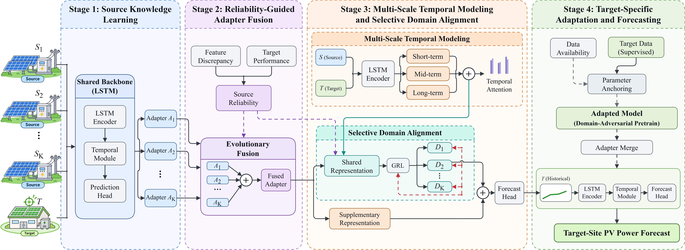

# RMAF-SDATN Cross-Regional Photovoltaic Power Forecasting



## Project Structure

```text
configs/                     Data, model, training, and experiment YAML files
data/raw/                    Original CSV, XLSX, and archives from data providers
data/processed/              Station power, quality reports, and capacity sources
data/splits/                 Temporal splits and window inventories
src/rmaf_sdatn/
  models/                    LSTM, LoRA, evolution attention, discriminators, and CycleNet
  algorithms/                Reliability, simplex search, alignment, and anchoring
  data/                      Cleaning, temporal windows, fold construction, and resumable downloads
  training/                  Four-stage training, early stopping, and checkpoint recovery
  evaluation/                Baselines, metrics, diagnostics, complexity, and figures
  experiments.py             Experiment matrices, source-pool analysis, and aggregation
  inference.py               Standalone prediction API
tests/                       Mathematical, gradient, recovery, data, and deployment tests
docs/                        Protocol records
```

## Environment and Installation

```powershell
python -m venv .venv --system-site-packages
.venv\Scripts\python.exe -m pip install
.venv\Scripts\python.exe -m pytest -q
```

If the required environment is already activated, you can also use the following commands. All `scripts/*.py` entry points prioritize the current repository to avoid interference from installed projects with the same package name.

```powershell
python -m pip install -r requirements.txt
python -m pytest -q
```

## Obtaining Real Data

```powershell
python scripts/download_data.py --dataset state_grid
python scripts/download_data.py --dataset pvod
python scripts/download_pvdaq.py
```

| Dataset | Provider Records | Files and Capacity |
|---|---|---|
| PVOD v1.0 | [ScienceDB](https://www.scidb.cn/en/detail?dataSetId=f8f3d7af144f441795c5781497e56b62), [Solar Energy data paper](https://doi.org/10.1016/j.solener.2021.09.050), [Authors' tools](https://github.com/yaotc/PVODataset) | The script downloads and extracts the ScienceDB V4 release archive. For manual downloads, extract `station01.csv`, `station02.csv`, `station04.csv`, `station06.csv`, `station07.csv`, `station08.csv`, and `metadata.csv` into `data/raw/pvod/`. Read `date_time,power` and convert `Capacity` from kW to MW, the unit of the power column, as specified in the data paper. |
| State Grid Competition | [Data paper](https://pmc.ncbi.nlm.nih.gov/articles/PMC9492786/), [Figshare V4](https://doi.org/10.6084/m9.figshare.17304221.v4), [Authors' repository](https://github.com/Bob05757/Renewable-energy-generation-input-feature-variables-analysis) | The script automatically downloads the original G5 and G7 XLSX files from a pinned commit in the authors' repository and verifies their Git object hashes. When manually using Figshare's `data_original.rar`, preserve the original filenames and place the files in `data/raw/state_grid/`. Rated capacities are taken from the original filenames and the station table in the data paper. |
| PVDAQ | [OEDI 4568](https://data.openei.org/submissions/4568), [Public S3 documentation](https://github.com/openEDI/documentation/blob/main/pvdaq.md), [Official access tools](https://github.com/NatLabRockies/pvdaq_access) | By default, the download script only lists files. After checking their sizes, add `--download`. Use `--stations` and `--max-bytes` to control the scope. Files are placed in `data/raw/pvdaq/`. |

Column names, rated capacity references, sampling intervals, and time zones can be specified in `configs/data.yaml` or `data/metadata/capacities.yaml`. For raw input formats, PVDAQ meter selection, and capacity discrepancies, see [Data Sources](docs/data_sources.md).

## Preprocessing, Splits, and Seeds

```powershell
python scripts/preprocess.py
python scripts/build_splits.py --target H7 --transfer mixed --budget 30
python scripts/build_splits.py --target H7 --transfer mixed --budget 1
python scripts/check_project.py --output outputs/project_audit_china.json
```

Preprocessing parses timestamps and time zones, checks the sampling grid, handles records with identical timestamps according to the configuration, counts anomalies and gaps, and normalizes power by rated capacity. By default, negative power and records with missing or nonfinite values are removed, while observed zero-power values are retained. Points exceeding rated capacity are counted by default; their removal is controlled by the limits in YAML. Windows spanning missing intervals are discarded, while valid historical context is retained.

H7, H8, G5, and G7 each serve as the target station. The remaining seven stations are automatically grouped into mixed, intra-regional, and inter-regional source pools according to their regions. The test window uses the 15-minute grid over the station's final 30 consecutive calendar days. The 30-day development set is divided into 4, 4, 16, and 6 days for Reliability, Fusion, Adaptation, and Validation, respectively. For budgets of 1, 3, 7, and 14 days, grid positions are allocated in the same proportions, with rounding, minimum window counts, and label boundaries checked. The default seeds are 42–46 and control Python, NumPy, Torch CPU/CUDA, DataLoader workers, and deterministic settings. Each run records its seed, raw data hashes, temporal boundaries, and valid sample counts.

## Training by Stage

The four commands use the same target, seed, configuration, and run directory. You can execute the Stage 4 command directly to complete all stages. Completed stages are restored automatically. After an interruption, the model, optimizer, early-stopping state, and Python, NumPy, PyTorch, and DataLoader random states can be restored from the last saved epoch. Stage 2 saves each generation's population, scores, elites, and search random state, allowing a rerun to resume from the last completed generation. Per-epoch training logs are written to `training.jsonl` in the trial directory.

### Stage 1: Shared Model and Source Adapters

```powershell
python scripts/train.py --target H7 --transfer mixed --budget 30 --seed 42 --run-dir checkpoints/h7-b30 --until-stage 1
```

### Stage 2: Reliability Estimation and Fusion

```powershell
python scripts/train.py --target H7 --transfer mixed --budget 30 --seed 42 --run-dir checkpoints/h7-b30 --until-stage 2
```

### Stage 3: Selective Domain Alignment

```powershell
python scripts/train.py --target H7 --transfer mixed --budget 30 --seed 42 --run-dir checkpoints/h7-b30 --until-stage 3
```

### Stage 4: Target Adaptation, Merging, and Evaluation

```powershell
python scripts/train.py --target H7 --transfer mixed --budget 30 --seed 42 --run-dir checkpoints/h7-b30 --until-stage 4
```

## Experiment Matrix

The main configuration iterates over four targets, three transfer settings, five budgets, and five seeds. Use `--targets`, `--methods`, `--variants`, `--budgets`, `--transfers`, and `--seeds` to narrow the scope. The experiment directory retains previous trials. Aggregated results are deduplicated by run directory, forecast step, and test subset when updated. Source-domain checkpoints are reused when the data, source pool, seed, and Stage 1 configuration match.

```powershell
python scripts/run_experiments.py --config configs/experiments/main.yaml
python scripts/run_experiments.py --config configs/experiments/main.yaml --targets H7 --transfers mixed --budgets 1 7 30 --methods rmaf target_only
python scripts/run_experiments.py --config configs/experiments/ablation.yaml
python scripts/run_experiments.py --config configs/experiments/fusion.yaml
python scripts/run_experiments.py --config configs/experiments/reliability.yaml
python scripts/run_experiments.py --config configs/experiments/stability.yaml
python scripts/run_experiments.py --config configs/experiments/sensitivity.yaml
python scripts/run_experiments.py --config configs/experiments/multihorizon.yaml
python scripts/run_experiments.py --config configs/experiments/modern.yaml
```

The basic baselines are Persistence, Target-only LSTM, Multi-source + FT, DANN, MMD-Transfer, and DeepCORAL. Extended baselines implement the patch-based Transformer in [PatchTST](https://github.com/yuqinie98/PatchTST) and the FFT-based periods, two-dimensional variations, and Inception residual blocks in [TimesNet](https://github.com/thuml/TimesNet), using MS+FT under a unified protocol.

`modern.yaml` also includes the residual cycle forecasting method in [CycleNet](https://github.com/ACAT-SCUT/CycleNet). It uses a learnable cycle table to subtract the historical cycle, then adds the future cycle back to the residual forecast. The cycle index is calculated from the historical window's starting position on the UTC 15-minute grid, using the same rule for training, testing, and standalone prediction. The default period is 96, with `revin: false`, and only capacity-normalized power is modeled. The cycle index is native operational information required by this baseline; RMAF still takes historical power as its input.

## PVDAQ Cross-Country Experiments

```powershell
python scripts/download_pvdaq.py
python scripts/download_pvdaq.py --stations 2107 --download --max-bytes 10000000
python scripts/download_pvdaq.py --download
python scripts/download_pvdaq.py --stations 7333 --download --workers 4 --chunk-mb 8 --max-bytes 3000000000
python scripts/preprocess.py --config configs/experiments/pvdaq.yaml --stations 2105 2107 9068 7333 9069
python scripts/build_splits.py --config configs/experiments/pvdaq.yaml --target 2107 --transfer external --window 2022-06-01
python scripts/run_experiments.py --config configs/experiments/pvdaq.yaml
python scripts/check_project.py --config configs/experiments/pvdaq.yaml --output outputs/project_audit_pvdaq.json
python scripts/run_experiments.py --config configs/experiments/pvdaq.yaml --keep-going
```

The full experiment uses all eight Chinese stations as sources. For each system and year, it processes 30-day windows starting on March 1, June 1, September 1, and December 1. If December data are insufficient, the window is moved back to the latest 30-day interval that meets the coverage requirement and does not overlap the other windows. Each season is trained and calibrated separately. Outputs are first aggregated with equal weights across seasons within each system-year, then summarized across systems and years.

The raw files for all five systems have been downloaded and checked. Under the default contiguous-window rules and 80% coverage requirement, 54 of the 60 seasonal windows are usable. System 7333 has substantial missing raw data in all four seasons of 2021 and the first two seasons of 2022. `check_project.py` records the reasons and actual temporal boundaries for each season. `--keep-going` continues with other usable seasons of the same system and retains a failure list.

## Testing, Aggregation, and Figures

```powershell
python scripts/evaluate.py --run-dir checkpoints/h7-b30
```

Each fold produces `metrics.json`, `predictions.csv`, `reliability.csv`, `adaptation.json`, stage histories, and diagnostic CSV files. RMSE, MAE, and R² are calculated using normalized power, while the CSV files also retain power in its original units. R² is left empty for constant labels. Main results include both daytime and nighttime samples; active periods, defined by observed normalized power greater than 0.05, are reported separately. The single-step ramp threshold is the 90th percentile of valid adjacent changes in the source training sequences and is used only during test evaluation. Multi-step models primarily report steps 4, 8, 16, and 24.

Each completed trial immediately saves `experiment_record.json`. If a later trial fails, the completed records are aggregated. After a process is forcibly terminated, the following command can restore the tables and regenerate the figures.

Standalone `train.py` also saves this record after completing Stage 4, so the same aggregation command can be used on its run directory. Training directories, downloaded files, and result indexes use exclusive write locks to prevent concurrent writes from overwriting each other.

By default, execution stops on data or training errors. For batch troubleshooting, add `--keep-going` to record failed targets or trials and their reasons in `failures.json` while continuing with other independent trials. Corresponding failure entries are removed after a successful retry.

```powershell
python scripts/summarize.py --root outputs/main --config configs/experiments/main.yaml
```

`evaluate.py` supports both Persistence and saved neural network checkpoints. Unknown configuration modes raise an error before training. Preprocessed files include verification hashes, and capacity and normalized power are also checked to prevent old splits from being reused after metadata changes.

Batch runs write `runs.csv`, `mean_sd.csv`, `negative_transfer.csv`, and tables grouped by target, transfer setting, budget, seed, ablation, season/system, or source-station combination. NTR compares trials with Target-only LSTM under the same target, budget, and seed, counting trials with strictly higher RMSE. Mean ± SD uses the sample standard deviation and includes actual counts. Diagnostics include discriminator balanced accuracy, RBF MMD, shared PCA coordinates, sample gates, and source alignment contributions during training. Figures are saved in `figures/` as PNG and SVG files using actual predictions and diagnostic data. Complexity records separately report training parameters, deployment parameters, affine FLOPs, training time, single-sample latency, and peak CUDA memory.

## Standalone Loading and Prediction

The input CSV must contain at least two columns: `timestamp,power`. Capacity and units are taken from the target station metadata saved in the training checkpoint. If `--station` or `--capacity` is provided, the program checks it for consistency. Retain at least the latest 12 consecutive measured observations. Timestamps with time zone offsets are parsed directly; timestamps without offsets use the target station's time zone by default.

By default, input data are already on the model's 15-minute grid. For measured power at a higher frequency, specify a sampling interval such as `--native-minutes 5`. The program aggregates right-closed intervals and uses only 15-minute intervals completed by the forecast issue time, retaining the minimum interval coverage setting used during training.

```powershell
python scripts/predict.py --checkpoint checkpoints/h7-b30/final_model.pt --input data/example_input.csv --output outputs/predictions.csv --station H7
```

A file can be exported from the processed real records to check the command workflow. The following operation uses the final segment of consecutive measured history in the H7 file and produces a forecast for the next time step.

```powershell
python -c "import pandas as pd; pd.read_csv('data/processed/H7.csv', usecols=['timestamp','power']).tail(12).to_csv('data/example_input.csv', index=False)"
```

```python
from rmaf_sdatn.inference import load_predictor, predict_csv

model, metadata = load_predictor("checkpoints/h7-b30/final_model.pt")
result = predict_csv("checkpoints/h7-b30/final_model.pt", "data/example_input.csv")
```

```powershell
python scripts/evaluate.py --run-dir outputs/paper_h7_seed42
python scripts/predict.py --checkpoint checkpoints/paper_h7_seed42/final_model.pt --input data/example_input.csv --output outputs/paper_h7_seed42/checkpoint_prediction.csv --station H7
```

## Frequently Asked Questions

- Cannot find `station*.csv`. The PVOD authors' tools archive contains only tools and some supporting materials. Download the published station CSV files and accompanying metadata and place them in the specified directory.
- Missing capacity or column names. Populate `data/metadata/capacities.yaml` using public metadata, ensuring that rated capacity and raw power use the same units. Retain the source file or data description in the capacity source field.
- Insufficient valid windows. Check the quality JSON, column units, timestamp format, and time zone. Long gaps require supporting raw records. All multi-step labels must also fall within a single subset; short budgets may not provide enough time slots.
- An existing checkpoint has a different configuration. Use a new run path or experiment name after changing the data or configuration.
- CUDA is unavailable. Check `torch.cuda.is_available()`, install a build compatible with the driver, or use the CPU. The default deterministic settings affect training speed.
